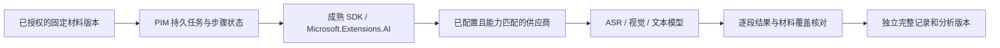

# AI 调用基础与开源组件选型

版本：v0.7。核对日期：2026-10-27。状态：SDK文字#514、多图视觉#515、可扩展MiMo单音频ASR#517均已合并，覆盖模型设置、实际内容记录和统计；完整CI及受控真实模型小样分别留证。**长录音持久任务、流式/部分结果、旧调用迁移和真实笔记质量未完成**。实现与限制见[文字调用](ai-text-model-settings.md)、[多图视觉](ai-vision-calls.md)、[ASR预设](ai-asr-presets.md)。唯一范围/45稳定编号和下一顺序以[总路线图](../product/native-notes-roadmap.md)为准，不另建产品台账。

用户要求先完善 AI 调用基础，再推进具体 AI 功能；底层调用优先采用成熟开源组件。模型请求协议、流式解析、供应商适配与通用重试优先由成熟组件承担；本期采用服务端 SDK 直连，不将独立网关列为前置。PIM 保留材料归属、版本、授权、任务状态和产物修订保护；这些业务规则不能交给模型自行决定。

## 0. 本轮明确的最小需求与待讨论项

2026-10-26 用户曾要求先记录下面三项再讨论轻量选型；需求继续有效，2026-10-27 的 SDK 直连确认见本节下文。**之前“继续采用 LiteLLM 作为必选网关”和“默认不保留实际提示词/回复”的建议撤回；不能把它们当成用户已确认的设计。**

| 项目 | 已明确的需求 | 仍待讨论的细节 |
| --- | --- | --- |
| 按模型类型设置 | 支持不同类型模型的配置；本批实现文本/视觉/语音转写声明、多配置和分别默认选择，凭据服务端加密 | 当前执行文本及PNG/JPEG多图视觉；本批通过预设接入MiMo单音频；其他厂商、长录音和更多类型仍需接入/验证 |
| 完整调用记录 | 保留实际提示词与实际回复；本批保留非流式文字的实际 SDK 正文、消息、结果和配置快照，沿用管理员查询权限 | 多模态引用、多图按可核对原字节的引用保存；流式/中断部分回复、保留期及清理操作待补，超限/写库失败边界保留 |
| 调用统计 | 本批展示记录数/终态成功率、进行中、上报 Token、平均耗时和模型分组；费用未知不按零解释 | 时间 UI、更多维度、计价/配额/清理未做，后续按实际需要收敛 |

2026-10-27 用户接受“Microsoft.Extensions.AI + 官方 OpenAI .NET SDK”的服务端直连方案，并要求完整同步路线图。NuGet 包为 `Microsoft.Extensions.AI.OpenAI` / `OpenAI`；兼容协议优先走该 SDK，确需厂商原生协议时用相应成熟 SDK，ASR使用真实音频接口/内容；MiMo采用其原生Chat input_audio，不能用文字/路径冒充音频。调用库放在 PIM 服务端，Android 通过 PIM API 访问，凭据留在服务端。模型协议、供应商适配与流式解析仍复用组件，不自写通用调用框架。

当前工程复用 `Microsoft.Extensions.AI.OpenAI` 10.6.0，本机解析包含 `OpenAI` 2.10.0 / `System.ClientModel` 1.10.0；这是本批已验证组合，不是最新版声明或依赖升级。新控制台用 SDK 直连 OpenAI-compatible 非流式 Chat Completions，独立开关默认关闭；现有业务仍使用旧环境配置及 LiteLLM，需完成旧调用方回归后再清理，不能将新控制台写成全体调用迁移。OpenAI SDK 的官方说明见[SDK 文档](https://developers.openai.com/api/docs/libraries)。

这些是通用 AI 配置/记录层的最小范围，不删除笔记本身对长音频、全部材料覆盖、持久任务和版本保护的要求；后者按具体笔记切片实现，不再用它们推导“必须先建设一套通用 AI 平台”。

## 1. 已有基础与实际缺口

| 仓内位置 | 当前事实 | 接入前要解决的问题 |
| --- | --- | --- |
| `Pim.Infrastructure.csproj` | 已引用 `Microsoft.Extensions.AI.OpenAI` 10.6.0 | 此版本是当前依赖，不代表调研时最新版；实施时锁定、验证兼容组合并保留许可证 |
| `AiChatClientFactory` / `AiProfileChatClientFactory` | 旧客户端保留；新直连按固定配置创建 SDK 客户端并释放，禁止重定向、通用重试为 0，正文审计不抓认证头 | 视觉有受控真实模型合成小样；ASR、流式和真实照片/笔迹质量仍待验收，不把本机HTTP当质量证明 |
| `AiGateway` / `AiDtos` | 已有文本调用、结构校验、请求关联和用量记录 | 旧`AiMessage`仍承载字符串；新直连通过SDK图文内容接入图片，MiMo单片ASR本批接通，长材料处理未完成，保留旧调用兼容 |
| `AiOptions` / `docker-compose.yml` | 默认 LiteLLM 地址；30 秒、1000 输出 token；最多两次应用尝试 | 不能用一个短请求参数覆盖 ASR、长文整理和分析；需要按能力配置限制，并统一重试预算 |
| Compose / LiteLLM 配置 | 已有 LiteLLM 服务与配置挂载，镜像使用 `main-latest` | 目标迁往 SDK 直连；先做兼容迁移与回归，再清理代理。现有 `main-latest` 和部署本轮未改变 |
| 提示词与响应日志 | 新非流式文字保留实际 SDK 请求/响应正文、消息和配置版本，已收到的非法 JSON/错误正文也保留；旧记录/开关不变 | 仅遮盖本次已知凭据并标记；4 MiB 响应上限/未收全正文/写库失败边界见实现说明，流式与保留清理待补 |
| `AiEndpoints` / `AiModelEndpoints` / Web AI 设置 | 管理员可设置模型、执行文本/多图调用、查询记录/原图/统计；文字基线5路径/8操作，本批另加4路径/4操作，唯一契约与生成类型已更新 | 视觉已接通PNG/JPEG，ASR已通过预设接通MiMo单片，长录音持久处理未完成；旧业务未自动迁移，不把管理员接口开放给普通用户 |
| 现有 Hangfire 与笔记版本库 | 已有后台任务基础及不可变完整材料收包 | 复用持久任务设施；新增业务步骤状态与重开恢复，不自建通用队列/工作流框架 |

这里记录源码事实，不证明生产部署已配置好模型。本批按用户明确授权使用其本机网关和合成材料进行4次真实服务层调用，密钥仅在内存；详见视觉说明的验证分类，不等于真实笔记或设备验收。

## 2. 组件比较与建议

以下“适合/不引入”是结合现有 .NET 工程的判断，不是上游承诺；供应商能力与部署验证仍需实际执行。

| 组件 | 上游提供的能力 | 本项目判断 |
| --- | --- | --- |
| **LiteLLM Proxy** | 统一模型入口；路由、超时、退避/回退；支持的 ASR 端点、视觉模型、用量关联。社区与企业目录许可分开 | **过渡兼容，目标不再以它作为必选网关**；SDK 直连及旧调用方回归后再清理现有服务/配置，当前并未移除。不把企业专属能力列为免费版已具备，外发模型和回退白名单由 PIM 配置约束。[路由](https://docs.litellm.ai/docs/routing)、[ASR](https://docs.litellm.ai/docs/audio_transcription)、[视觉](https://docs.litellm.ai/docs/completion/vision)、[许可](https://github.com/BerriAI/litellm/blob/main/LICENSE) |
| **Microsoft.Extensions.AI + 对应 SDK** | .NET `IChatClient`、多模态/流式表示、DI 中间件、观测等；已在本仓使用；扩展库为 MIT | **已确认：服务端 SDK 直连的 .NET 调用基础**；文本/视觉复用已有抽象，ASR使用所选协议的成熟SDK和真实音频内容，MiMo Chat input_audio不等于普通文字调用。无需先引入另一套语言服务。[说明](https://learn.microsoft.com/en-us/dotnet/ai/microsoft-extensions-ai)、[许可](https://github.com/dotnet/extensions/blob/main/LICENSE) |
| Microsoft Agent Framework / Semantic Kernel 路线 | Agent、工具、会话及显式工作流；官方将 Agent Framework 定位为 Semantic Kernel/AutoGen 后继 | 作为以后需要复杂工具编排时的候选；当前笔记是固定步骤，本轮不把 Agent 平台建设列为前置任务，也不假定它能自动解决材料版本和长录音覆盖。[官方概览](https://learn.microsoft.com/en-us/agent-framework/overview/) |
| Dify | 带界面的 AI 工作流、模型/工具和知识库平台；许可证为附加条件的 Apache 2.0 版本，包含 workspace 多租户及前端品牌条件 | 本轮不引入：会增加独立平台的账号、文件和任务管理对接。若未来选择可视化运营平台，再评估许可和部署；不能将其标为无附加条件的 Apache 项目。[仓库](https://github.com/langgenius/dify)、[许可](https://github.com/langgenius/dify/blob/main/LICENSE) |
| LangGraph | 开源持久执行/人工介入编排；Python/JS 生态，开源库许可 MIT；托管平台另计 | 保留候选；现有 .NET + Hangfire 可覆盖首批固定任务，当前不为编排再增加运行时。开源库与托管服务不混为一项。[说明](https://docs.langchain.com/oss/python/langgraph/overview)、[许可](https://github.com/langchain-ai/langgraph/blob/main/LICENSE) |

本期已确认组合为“Microsoft.Extensions.AI + 官方 OpenAI .NET SDK/所需厂商 SDK 直连 + PIM 既有配置、调用记录和统计”。配置、记录和统计是 PIM 的产品能力，SDK 不会自动提供对应页面或存储。现有后台设施只在具体笔记的长任务/版本保护中复用，不扩成通用 AI 平台。开源网关不保证所有模型都有视觉、ASR、结构输出或取消能力。每个模型别名必须有经核实的能力说明，不能仅凭一个兼容地址就允许任何任务。

## 3. 责任与数据流

- 材料从服务器受控存储流式读取；不把本机路径、服务器路径或账号凭据当作模型输入。图片必须实际进入支持视觉的请求，音频必须实际进入 ASR；按 SDK 和模型限制准备数据，不用文件名替代内容。
- 文本、视觉、ASR 使用独立能力配置：模型别名、输入/输出限制、时限、并发/用量、允许供应商和回退目标。能力不足提前报错；不静默丢参数、图片、音频或正文后半部分。
- 选定的 SDK/可选代理组合必须明确一个通用重试负责人，设置总尝试、总时限和费用预算。保留业务层明确的“重新处理”，但不能让 SDK、代理和原有应用循环乘法重试；鉴权/格式错误不能无差别重试。
- 结构校验后的语义修复与传输重试分别记账，都受同一逻辑任务预算约束；不能简单删除旧调用方的结构修复语义，也不能用后台任务自动重试再放大一层模型调用。
- 任务只固定非秘密身份与版本引用，凭据留在受保护的服务端配置中。用户退出、撤回同意、删除材料及任务结果迟到时的行为需要持久规则；不得以临时 HTTP 取消成功冒称上游费用或外部数据已撤销。
- 任何供应商切换都必须符合本次同意的外发范围。模型路由、提示词/处理算法版本与材料摘要记录在任务中；“同一个别名”换了底层模型不能无条件复用旧处理缓存。
- 原始材料、ASR 文本、完整记录、独立分析和人工修订分别保存。重生成新建派生版本，带来源与步骤状态，不能覆盖用户已改稿；原稿/附件中的文字仅为待分析数据，不自动触发工具写入或创建任务。

## 4. 最小通用层与后续笔记处理的验收边界

通用层以第0节三项需求为范围：按类型配置、实际提示词/回复留存、调用统计。下面的视觉、正式ASR、长材料、持久步骤和版本保护是笔记业务逐步接入时的质量要求，不能据此扩大通用层为完整网关/工作流平台，也不把全部笔记处理完成当作开始完善正式客户端的前置。

| 能力 | 最小验收证据 | 未通过时的行为 |
| --- | --- | --- |
| 配置、认证与复现 | 固定组件版本/摘要；服务重开可加载；无密钥出现在客户端、响应、普通日志或材料中；管理员可辨别未配置/失效/禁用 | 明确不可用，保留本机记录；不自动借用另一用户/服务器配置 |
| 文本、流式与结构输出 | 非流式/流式、结束原因、取消、结构校验；实际模型调用与合成故障测试分开；旧文本调用方回归 | 结构失败不写业务结果；流断和长度截断不能标完整成功 |
| 视觉 | 正文、至少两张内容不同的照片/手写图实际参与；故意遗漏一张时覆盖核对失败；模型不支持时提前拒绝 | 标缺失材料，不用文件路径或 OCR 猜测冒充完整输入 |
| 正式 ASR | 可辨识中文音频、多段、静音、失败段；确认实际模型返回；记录模型/格式/语言/大小时长限制 | 逐段给出失败原因，保留音频；静音不捏造文字 |
| 长材料 | 超过短请求限制的音频/长文/多图片；按供应商实际限制切分、保留段内时间偏移，输出逐项覆盖清单 | 任何缺块、截断或无法覆盖都显示部分完成，不能静默裁剪 |
| 持久步骤与重开 | 排队/运行/部分失败/成功/取消/结果未确认状态；进程在调用前后退出、断网和 429/5xx；重试只重做必要步骤 | 不用内存 Task 当队列；上游结果未知时不无界重复计费，先核对并保全现场 |
| 配额与观测 | 保留实际提示词、实际回复及统计，并关联模型和请求；具体统计/配额字段后续收敛 | 需要限制时明确等待/拒绝；受控调用记录保留实际内容，普通日志和认证凭据分离 |
| 版本与权限 | A 处理时修改为 B、补录、重复请求、跨用户访问、结果乱序、人工修订后再生成 | 输入/产物/人工稿互不串版；跨用户拒绝，旧结果不能覆盖新稿 |
| 验证分类 | 假服务证明协议和故障处理；受控真实模型证明能力/质量；真实设备证明采集与体验，各自保留版本证据 | 未执行项记未验证；不拿“ok”、mock 或 CI 数量替代真实 ASR/视觉/课堂验收 |

用户已明确需要保留实际提示词与回复；调用记录属于受控业务数据，不能用“隐私”为由只存摘要/元数据或擅自关闭内容保存。认证头和密钥仍不属于提示词/回复记录。普通运行日志、可选代理及回调中的重复内容记录另行约束；LiteLLM 日志能力见[上游说明](https://docs.litellm.ai/docs/proxy/logging)，不据此决定是否选用代理。本仓现有两个全文保存开关仍为 true，本轮不改配置。基础验收不要求先建统一 AI 聊天平台、模型商店、RAG、向量库或多 Agent 系统。

## 5. 依赖顺序与开发切片

| 顺序 | 可独立评审的交付 | 下一步的入口条件 |
| --- | --- | --- |
| 第一批：最小文字调用闭环（#514已合并） | 管理员设置多类型模型/默认值；SDK直连文本；实际消息/正文/回复与统计可查。单次请求幂等、会话保护、取消/超时/未知恢复和配置冲突均有本地证据；见[实现说明](ai-text-model-settings.md) | #514完整CI和主干发布已通过；Web合成接口、实际SDK/本机HTTP与真实供应商验收分开，未配置真实模型不冒称已验证 |
| 第二批：视觉与单片ASR基础（#515/#517已合并） | 本批接PNG/JPEG多图、逐次目的地确认与原图留存；本批通过可扩展预设接MiMo单音频；长音频持久步骤、笔记照片/手写版本及流式/部分结果后续补齐，用成熟SDK | 内容实际进入支持对应能力的模型，音频/图片不当作路径字符串；合成故障与受控真实调用证据分开 |
| 第三批：兼容迁移与清理 | 旧 AI 调用方回归、凭据/配置切换、记录与统计完整性通过后，清理 LiteLLM 部署和配置 | 不留下调用方仍指向已删除代理；当前代码/部署未做此迁移，不能提前标已移除 |
| 笔记持久任务和版本保护 | 在具体笔记处理切片用现有 Hangfire 承载可重开步骤，记录材料覆盖、幂等键及结果未确认边界，派生稿/人工稿分离 | 重开、部分失败、配额及 A/B 乱序不覆盖；这些业务要求保留，但不扩大通用设置/调用记录层的最小范围 |
| 正式安卓记录与上传 | 修复 #41；完成正式导航、列表/编辑状态及可靠首次结束，再接账号/服务器绑定的上传队列；按唯一契约刷新生成类型 | 提交与转写状态真实，切账号/服务器/退出和离线恢复有证据；当前顶部预览按钮不能充当正式交付入口 |
| 笔记完整处理与发布 | 逐段 ASR → 全材料完整记录/独立分析 → 人工修订保护/失败恢复/冲突 UI；最后做整次课堂与平板验收 | 全部 M1+M2 必需项、正式 UI、OPPO 100/180 分钟及异常验收通过，方可正式发布笔记功能 |

每个切片在实施时补具体 issue/PR、涉及的现有需求编号、契约变化和证据，状态回写唯一总路线图。服务端可单独合并；安卓预览代码合并和正式功能发版另按验收门槛处理。Windows 记录、Web 编辑、任务建议与全部既有业务迁移仍保留在原台账。

## 6. 本轮交付边界

本轮实现最小文字调用闭环、EF迁移、管理端页面和对应实际契约，不改 SDK 版本、旧日志开关、LiteLLM 镜像/部署，不改变生产供应商配置；按用户授权在隔离进程内使用本机网关做合成小样，密钥不落盘。本批视觉基础及受控真实模型小样见[视觉说明](ai-vision-calls.md)；单片ASR/预设见[说明](ai-asr-presets.md)；长录音、流式、旧调用迁移与笔记持久步骤仍分别验收；运行边界、统计和内容留存限制见[实现说明](ai-text-model-settings.md)。后续 API 形状继续先服务端实现并导出唯一 `contract/openapi.json`，再生成客户端类型，不将规划当成现成接口。

同批联查修复现有 AI 质量巡检的成功状态比较：识别实际存储 `succeeded` 与旧 `Success`，进行中不计为失败，过期未确认仍可显式计入终态；查询仅投影状态/错误字段，避免把完整调用内容载入巡检内存。它不改变旧业务调用配置或自动迁移旧供应商。
